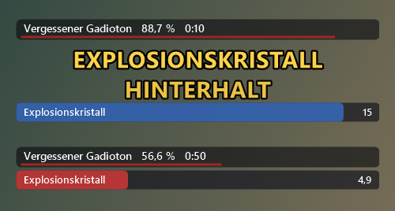

# Raid-Ansager für Aion 2

Sagt in **Dungeons und Raids** an, was der Boss gerade macht: per Sprache, Warnton und Text über dem Spiel, mit
Boss-HP und Countdown-Balken für Fähigkeiten, die regelmäßig kommen. Er liest den Netzwerkverkehr von Aion 2 nur mit
(Npcap, wie Wireshark) und verändert nichts am Spiel.



- **Jeder Dungeon-Boss:** Seine Fähigkeiten werden mit dem Spielnamen vorgelesen, sobald er sie beginnt
  (z. B. „Drana-Welle“, „Orbwurf“).
- **Bosse mit Boss-Mod**, zuerst der Raid **Ludra**: eigene Ansagen, Phasen nach HP, Countdown („… in 5“), Ansagen je
  Rolle (Tank, Heiler, DD).
- Kampfprotokoll zu jedem Pull, daraus lassen sich neue Boss-Mods bauen.

> **Achtung:** Laut einem anderen Tool-Autor stuft der NCSOFT-Support Software, die Spieldaten mitliest, als Verstoß
> gegen die Nutzungsbedingungen ein. Die Nutzung erfolgt **auf eigenes Risiko**.

## Download

1. [**Npcap**](https://npcap.com/#download) installieren (Standardoptionen).
2. Unter [**Releases**](../../releases/latest) die Datei `RaidAnsager.exe` herunterladen und starten. Eine Installation
   ist nicht nötig, .NET ist enthalten. Bei der SmartScreen-Warnung: *Weitere Informationen → Trotzdem ausführen*.
3. Das Lautsprecher-Symbol unten rechts öffnet per Rechtsklick die Einstellungen.
   **Strg+Alt+O** verschiebt das Overlay, **Strg+Alt+M** schaltet stumm, **Strg+Alt+T** spielt eine Test-Ansage.

Aion 2 im Fenster- oder randlosen Modus spielen, sonst liegt das Overlay unter dem Spiel. Die Ansagen hört man
trotzdem. Die vollständige Anleitung steht in der **[LIESMICH](LIESMICH.md)**.

## Boss-Mods

Wie Ansagen für einen Boss aufgebaut sind, steht in [MODS.md](MODS.md). Die eingebaute Ludra-Mod liegt unter
[`mods/ludra.json`](mods/ludra.json). Ihre HP-Schwellen stammen noch aus Guides zur alten Version und werden nach den
ersten Raidabenden anhand echter Mitschnitte überarbeitet.

## Selbst bauen

```
git clone --recurse-submodules https://github.com/dr89mh/aion2-raid-ansager.git
cd aion2-raid-ansager
dotnet build -c Release     # bin\Release\net10.0-windows\RaidAnsager.exe
publish.cmd                 # dist\RaidAnsager.exe (eine Datei, .NET enthalten)
```

Voraussetzung: .NET 10 SDK. Mitlesen, TCP und Framing kommen aus dem Kern des
[Cube Radar](https://github.com/dr89mh/aion2-cube-radar) (Submodul `external/aion2-cube-radar`).

Befehle für die Auswertung (Npcap nötig):

| Befehl | Wirkung |
|---|---|
| `RaidAnsager analyse <aufnahme.pcapng …> [--out ordner]` | Boss-Kämpfe auswerten: Protokoll je Pull, Fähigkeiten-Tabelle (Abstände, HP, Vorlauf), Mod-Entwurf |
| `RaidAnsager replay <aufnahme.pcapng> [--speed 4]` | Aufnahme mit Overlay und Sprache abspielen |
| `RaidAnsager vorschau <aufnahme.pcapng> [--mod datei] [--alle]` | ohne Ton: Ansageliste und Overlay-Bilder schreiben |
| `RaidAnsager pruefen` | Boss-Mods laden und prüfen |

| Pfad | Inhalt |
|---|---|
| `Protocol/CombatDecoder.cs` | Frames → Ereignisse: Cast `02 38`, Treffer `04 38`/`05 38`, HP `00 8D`, Buff `2A 38`/`2B 38`, Spawn `41 36`, Tod `04 8D`, Zone `01 40` |
| `Engine/Announcer.cs` | Kampferkennung (Pull, Sieg, Reset), Trigger, Phasen, Balken, Lernmodus |
| `Engine/BossMod.cs` | Mod-Format und Laden (eingebaut + Ordner, höchste Version gewinnt) |
| `Analysis/` | Kampfprotokolle, Statistik, Mod-Entwurf, Befehle |
| `App/` | Live/Wiedergabe, Overlay, Sprache, Tray, Einstellungen |
| `data/` | deutsche NPC- und Skillnamen, erzeugt mit `tools/make_data.py` |

## Lizenz

GPL-3.0. Die NPC- und Skilldaten und Teile des Protokollwissens stammen aus
[cyberbadger6969/aion2-dps-meter](https://github.com/cyberbadger6969/aion2-dps-meter) (GPL-3.0). Weitere Paketlayouts
stammen aus HamMeter-Aion2 und aion2dps (TheLoop705). Spielinhalte und Namen gehören NCSOFT.
